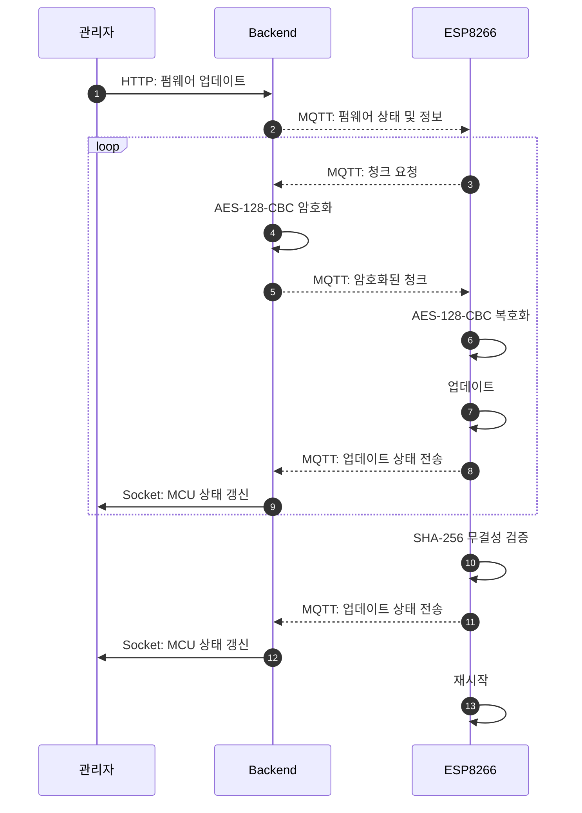

# OTA (Over-The-Air) System

ESP8266 기반 장치의 펌웨어를 무선으로 업데이트하고, 백엔드와 웹 대시보드에서 장치 상태를 관리하는 풀스택 프로젝트입니다.

## 프로젝트 개요

이 프로젝트는 ESP8266 장치가 네트워크를 통해 서버로부터 펌웨어를 받아 업데이트할 수 있도록 구성하고, 웹 대시보드를 통해 장치와 펌웨어 상태를 실시간으로 확인하고 업데이트할 수 있도록 구현했습니다.

## 주요 기능

- 무선 펌웨어 업데이트
- 펌웨어 무결성 검사
- MQTT 기반 MCU와 백엔드 간 통신
- 펌웨어 업로드 및 배포
- MCU 연결 상태 및 펌웨어 버전 확인

## 시스템 구성

```text
OTA/
├── backend/ota/     # NestJS
├── frontend/ota/    # Vue
└── firmware/ota/    # ESP8266
```

## OTA 흐름도

<div align="center" style="zoom: 80%; width: 80%;">
    


</div>

## 기술 스택

| 영역 | 기술 |
| - | - |
| Firmware | PlatformIO, ESP8266, PubSubClient |
| Backend  | NestJS, Socket, Mosquitto, MySQL, TypeORM |
| Frontend | Vue, Bootstrap, Socket |

## 시현 영상
[](https://github.com/user-attachments/assets/3af824c4-dd78-4224-aab3-12593e04cf97)


<video src="https://1drv.ms/v/c/dd3bc808d6b4a8bc/IQD-uGc8giUkR4IZXQdX9JqOAQ-AmOSF7j4mvsVIffB_xmw"></video>

## 구현 포인트

### 1. OTA 업데이트 구조 설계

서버는 장치 상태와 배포 정보를 저장하고, MQTT를 통해 업데이트 명령을 전달하며 장치가 필요한 펌웨어를 다운로드하고 적용하도록 구성했습니다. 이를 통해 장치별 업데이트 상태를 추적할 수 있도록 설계했습니다.

### 2. 펌웨어 분할 전송 구조 설계

ESP8266 메모리와 <abbr title="MQTT 클라이언트 네트워크의 버퍼를 늘릴 수도 있지만 늘릴 경우 OTA 시스템 때문에 차지하는 메모리가 커지게 된다.">MQTT 클라이언트 네트워크 버퍼가 제한적이다.</abbr> 따라서 펌웨어를 한 번에 전송하지 않고 펌웨어를 일정 크기로 분할하여 전송하도록 설계했습니다.

### 3. 실시간 상태 모니터링

Socket를 활용해 MCU 상태, 버전 정보, 배포 상태를 실시간으로 확인할 수 있도록 구현했습니다. 단순히 API 응답를 확인하는 수준이 아니라, 사용자에게 바로 반영되는 상태 변화 반영을 구성했습니다.

### 4. 보안 및 데이터 무결성

펌웨어와 통신 과정에서 AES-128-CBC(PKCS#7)와 SHA-256를 적용하여 데이터가 그대로 전송되지 않고 보안과 데이터 무결성 문제를 해결했습니다.

## 프로젝트 성과

- IoT 장치와 서버 간 통신
- 보안 요소를 고려한 데이터 전송
- 데이터 분할 전송 구조
- 실시간 대시보드
- 무결성 검사
```
